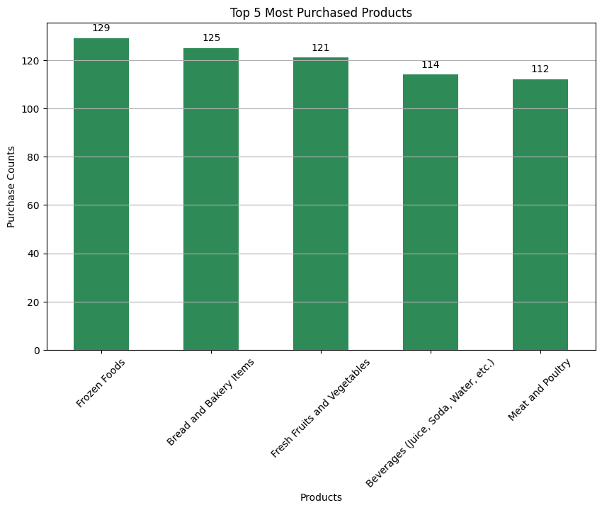
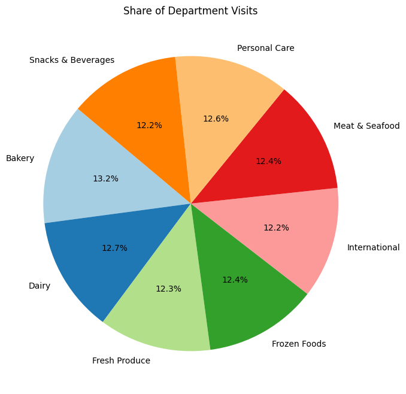
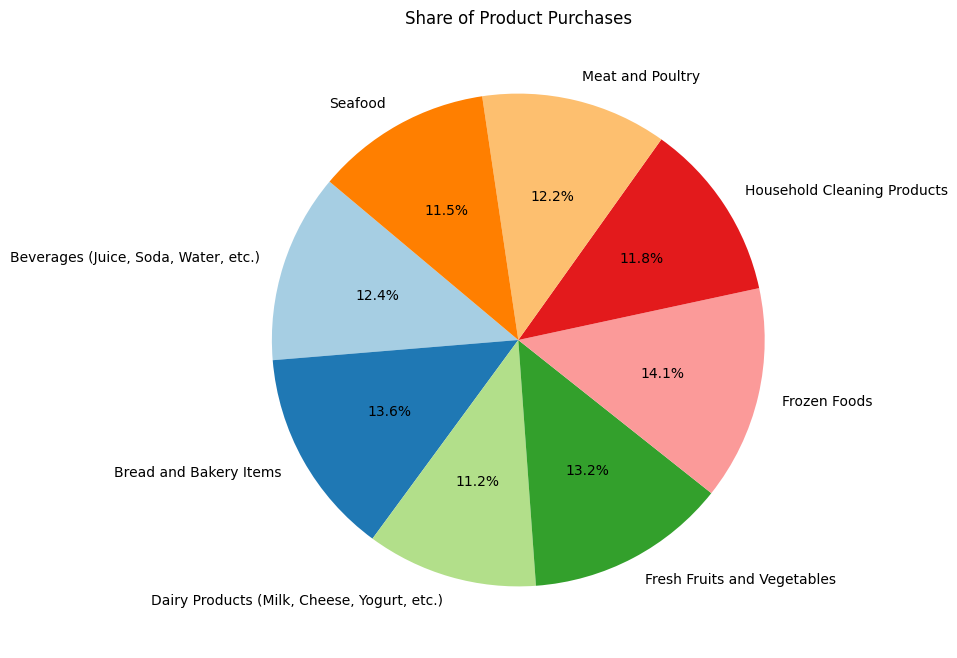
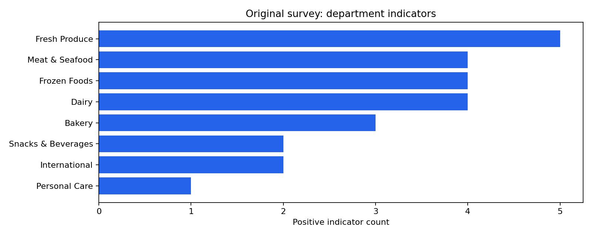
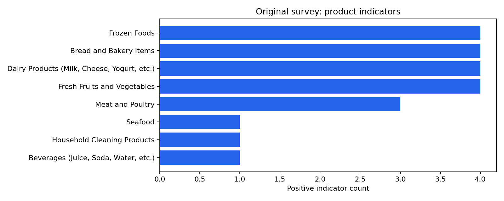

# Customer Survey Indicators

**Author:** Mohammed Adeen Shaik  
**Review date:** 11 October 2026

## Research question

Which departments and products receive the most binary selections in the supplied tables?

## Data and provenance

Original survey workbooks plus explicitly simulated expanded workbooks.

Source materials are linked from the repository README. Input fingerprints are recorded in [the evidence manifest](evidence.json) so a reader can identify the exact committed artifacts used in this review.

## Method and analytical rationale

Indicator columns are checked as binary and summed. Rankings count selections, not sales units. Original and expanded results must be interpreted separately.

## Findings and interpretation

The original survey workbooks are a small observed sample. DataModeling.ipynb expands them with independently simulated binary observations; Data_Analysis.ipynb plots expanded observations. Those charts demonstrate visual reporting only. They do not strengthen population inference; use separately labelled original-sample summaries for empirical interpretation.

## Limitations

Expanded observations are simulated for visualization practice. Independent random binary values do not reproduce customer correlations. Multiple selections mean shares of selections are not shares of unique customers.

## Reproduction

Use the setup commands and input contract in the [repository README](https://github.com/Adeen1607/Customer-Survey-Analytics-with-Python#readme). Open the [notebook catalogue](notebooks.html) for annotated code and saved outputs. Keep raw records and model binaries local; public reports contain aggregate results or source-embedded figures.

## Final visual results

*Figure from Data_Analysis.ipynb, original code cell 17.*

*Figure from Data_Analysis.ipynb, original code cell 19.*

*Figure from Data_Analysis.ipynb, original code cell 21.*

*Reproduced aggregate figure: department-original.png.*

*Reproduced aggregate figure: product-original.png.*

